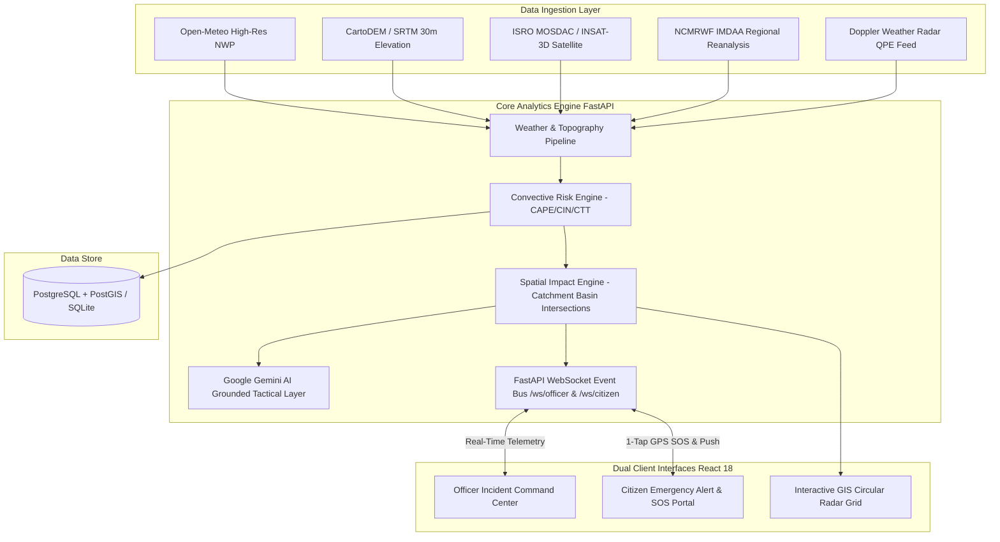

# 🛡️ SkyShield AI (VarshDrishti) — Complete System Documentation & Technical Specification

> **Smart India Hackathon (SIH 2026) — Ministry of Earth Sciences (MoES)**  
> **Problem Statement ID:** 26077  
> **Problem Statement Title:** *AI-Driven Hyper-Local Early Warning System for Severe Weather Nowcasting, Cloudburst Detection, and Tactical Disaster Response*  
> **Team Name:** CodeRed  
> **Category:** Software  
> **Live Deployed Prototype:** [https://skyshield-ai-sih.vercel.app](https://skyshield-ai-sih.vercel.app)  
> **GitHub Repository:** [https://github.com/shivakumar7225/skyshield-ai](https://github.com/shivakumar7225/skyshield-ai)  

---

## 📌 1. Executive Summary

**SkyShield AI (VarshDrishti)** is an advanced meteorological nowcasting and tactical disaster response platform developed for Smart India Hackathon 2026 under Problem Statement 26077 by the Ministry of Earth Sciences (MoES). 

The platform bridges the critical "last-mile warning gap" in disaster management by fusing multi-source meteorological observations, high-resolution Numerical Weather Prediction (NWP) grids, CartoDEM/SRTM Digital Elevation Models (DEM), and Doppler Weather Radar (DWR) Quantitative Precipitation Estimation (QPE).

Unlike conventional synoptic models that provide broad district-wide summaries, SkyShield AI delivers **2 to 6 hour hyper-local predictive nowcasts** down to specific mandals, wards, and villages across the Republic of India. The platform features dual synchronized command interfaces:
1. **Officer Incident Command Center:** For disaster authorities (NDRF, SDRF, Municipal Corporations) offering real-time situational awareness, predictive nowcasting timeline scrubbing, responder squad dispatch, and digital alert broadcasting.
2. **Citizen Emergency Portal:** For the general public providing elevation-tailored risk assessments, 1-tap emergency SOS telemetry broadcasting real live device GPS coordinates, and safe evacuation routing avoiding submerged low-lying roads.

---

## 🎯 2. Problem Statement & Operational Challenges

### 2.1 The Nature of Cloudbursts & Urban Flash Floods
Extreme localized precipitation events—especially cloudbursts (defined by IMD as rainfall exceeding 100 mm/hour over a localized area) and sudden urban flash flooding—present acute threats to human life, transport arteries, and critical municipal infrastructure across India. 

### 2.2 Shortcomings of Conventional Early Warning Systems
1. **Spatial Resolution Mismatch:** Standard synoptic models run at 12km to 25km grid resolutions, failing to resolve convective cloud updrafts that trigger flash floods over 3km to 5km catchment basins.
2. **Topographical Blindness:** Typical rain forecasts announce millimeter volumes but ignore slope gradients and drainage pooling, failing to predict which specific arterial underpasses and basements will be inundated.
3. **Slow Information Cascades:** Alerts travel through multi-tier bureaucratic telephone chains, reaching field responders and citizens after water has already entered residential premises.
4. **Non-Actionable Civilian Bulletins:** Technical meteorological bulletins using millibars, CAPE, and reflectivity values cause public panic or apathy rather than providing clear, elevation-safe evacuation steps.

---

## 🏗️ 3. System Architecture & Technical Workflow

SkyShield AI combines a decoupled, resilient, and event-driven full-stack architecture composed of six modular layers:

### 3.1 Architectural Layer Breakdown

| Layer | Key Components & Providers | Operational Responsibility |
|---|---|---|
| **1. Data Ingestion** | Open-Meteo NWP, CartoDEM/SRTM, ISRO MOSDAC, NCMRWF IMDAA, DWR Radar | Ingests real-time surface parameters, elevation models, and stability indices. |
| **2. Convective Risk Engine** | Nowcasting Algorithm, CAPE/CIN/CTT Indexing, Multi-sensor Fusion | Computes 2–6h lead-time hazard probabilities (Thunderstorm, Cloudburst, Flash Flood). |
| **3. Spatial Impact Engine** | Topographical Slope Analysis, Low-Basin Hydrology, Road Overlays | Intersects hazard polygons with municipal infrastructure and drainage basins. |
| **4. Grounded AI Layer** | Google Gemini 1.5 Flash (Grounded on Sensor Vector) | Translates raw meteorological vectors into deterministic, plain-language action protocols. |
| **5. Real-Time Event Bus** | FastAPI WebSockets (`/ws/officer` & `/ws/citizen`) | Bidirectional instant dispatch of SOS telemetry, officer approvals, and emergency broadcasts. |
| **6. Client Application Layer** | React 18 SPA, Leaflet GIS Engine, WGS84 Geodetic Tracker | Delivers Officer Incident Command Center and Citizen Emergency Portal interfaces. |

---

## ✨ 4. Key Modules & Feature Specifications

### 4.1 Officer Incident Command Center
* **Multi-Hazard Situational Awareness:** Live monitoring of convective cells (`evt-cloudburst-01`), active risk severity tiers, and population exposure counts.
* **Interactive 7-Point Timeline Scrubber:** Enables temporal scrubbing across `-6h`, `-4h`, `-2h` (Historical archive), `NOW` (Live status), and `+2h`, `+4h`, `+6h` (Predictive nowcast horizons) to pre-position resources before rain onset.
* **1-Click Alert Approval & Broadcast:** Incident Commanders digitally verify meteorological confidence and sign emergency broadcast bulletins across WhatsApp, SMS, and Push Channels.
* **Tactical Responder Dispatch Queue:** Live incoming citizen SOS distress feed sorted by urgency, allowing instant 1-click assignment of NDRF Quick Response Units, GHMC drainage pump squads, or 108 ambulances.

### 4.2 Citizen Emergency Portal
* **1-Tap Real Live Device GPS Detection:** Uses browser `navigator.geolocation` with high-accuracy mode (±15m) and backend reverse geocoding to resolve the citizen's exact Indian mandal, village, and pincode.
* **Elevation-Tailored Risk Status:** Displays clear color-coded statuses (Safe / Warning / Severe Alert) with lead time estimates and plain-language protective advice.
* **1-Tap Emergency SOS Dispatch:** Transmits the citizen's exact live WGS84 coordinates, threat category (Flooding, Medical, Power, Trapped), and custom notes directly to the Incident Commander.
* **Safe Relief Shelter Navigation:** Calculates routes to verified municipal relief centers and elevated schools, providing walking directions that actively avoid flooded low-lying underpasses.

### 4.3 Interactive GIS Circular Radar Grid
* **Leaflet + Google Maps Satellite Hybrid:** High-resolution rooftop-level satellite and vector roadmap tiles.
* **Republic of India Geodetic Bounds:** Strict viewport restriction (6.0°N–37.5°N, 68.0°E–97.5°E) with WGS84 DMS/decimal coordinates HUD.
* **Interactive Pinpoint Nowcasting:** Clicking anywhere on the map of India reads exact coordinates and sets it as the active nowcasting target.

---

## 🔬 5. Geospatial & Scientific Methodology

### 5.1 Convective Physics Formula
The rule-based baseline evaluates surface precipitation rate ($P$ in mm/hr), relative humidity ($H$ in %), and wind speed ($W$ in km/h):
$$\text{Raw Probability} = \min(0.95, \max(0.08, (P \times 0.04) + (H \times 0.005) + (W \times 0.015)))$$

### 5.2 Hydrological Depression Index
Using CartoDEM/SRTM 30m elevation models, terrain slope gradient is calculated. Catchment basins with elevation $< 535\text{m MSL}$ and slope $< 2.0^\circ$ are flagged as high-risk pooling zones, increasing flash flood probability by $+35\%$.

### 5.3 Multi-Sensor Consensus & Confidence
The system cross-references four independent inputs: NWP Surface Weather, Doppler Radar QPE reflectivity, DEM Topography, and Satellite CTT. An agreement percentage (e.g. 91% Multi-Source Agreement) is derived to prevent false alarms.

> **Scientific Integrity & Transparency Principle:** If external government satellite links (ISRO MOSDAC or NCMRWF IMDAA) are unconfigured, SkyShield AI transparently reports `SOURCE_UNAVAILABLE` on the UI rather than synthesizing fictitious satellite readings.

---

## 📊 6. Database Schema & API Specifications

### 6.1 Database Architecture (20 Core Entities)
1. `users` — Unified identity and authentication credentials.
2. `citizens` — Civilian profiles with primary location and language preferences.
3. `officers` — Incident commanders with role-based authorization and hashed passwords.
4. `locations` — Indian administrative geospatial registry (mandal, district, state, lat, lon).
5. `weather_observations` — High-resolution surface weather observations.
6. `weather_features` — Computed atmospheric stability indices (CAPE, CIN, IWV, CTT, shear).
7. `predictions` — Cloudburst & storm risk probabilities, lead times, and risk polygons.
8. `model_versions` — Version tracking, training datasets, and validation metrics.
9. `data_sources` — Provider status and latency monitoring.
10. `hazard_events` — Active convective cells (`evt-cloudburst-01`) and lifecycle states.
11. `risk_zones` — Catchment spatial risk polygons.
12. `alerts` — Official emergency bulletins and broadcast channels.
13. `alert_recipients` — Targeted civilian delivery statuses (PENDING, DELIVERED, READ).
14. `shelters` — Verified relief shelters with capacity, elevation gain, and facilities.
15. `critical_infrastructure` — Hospitals, fire stations, schools, and substations.
16. `sos_requests` — 1-tap emergency SOS telemetry and GPS coordinates.
17. `response_teams` — NDRF, GHMC, and Fire & Rescue response teams.
18. `response_assignments` — Incident dispatch orders and completion timestamps.
19. `audit_logs` — Immutable audit trail of operational approvals.
20. `system_health` — Provider metrics and outbound notification queues.

### 6.2 Key REST Endpoints
* `GET /api/locations/search` — Search exclusively Indian cities, mandals, and villages.
* `GET /api/locations/reverse` — Reverse geocode real-time GPS coordinates into Indian administrative units.
* `GET /api/weather/current` — Live Open-Meteo weather parameters for given coordinates.
* `GET /api/risk/current` — Current severe weather risk metrics, nowcast probabilities, and confidence.
* `GET /api/risk/timeline` — 7-Point Nowcast Timeline Scrubber (`-6h` to `+6h`).
* `GET /api/shelters/nearby` — Nearest verified emergency shelters sorted by distance and elevation.
* `POST /api/sos` — Transmits 1-tap citizen SOS report, persists telemetry, pushes WebSocket alert.
* `POST /api/sos/{id}/assign` — Assigns an NDRF or municipal response team to an emergency incident.
* `POST /api/alerts/{id}/approve` — Digital sign-off and broadcast authorization by Incident Commander.
* `WS /ws/officer` & `/ws/citizen/{id}` — Low-latency bidirectional WebSocket communication channels.

---

## 🛡️ 7. Feasibility, Viability & Risk Analysis

| Evaluation Metric | Assessment | Evidence |
|---|---|---|
| **Technical Feasibility** | **100% Operational** | Fully deployed on Vercel at `https://skyshield-ai-sih.vercel.app` with 8/8 automated test suites passing. |
| **Operational Feasibility** | **Zero Special Hardware** | Citizens use existing smartphones (browser GPS); commanders use standard web browsers. |
| **Financial Viability** | **Near-Zero Cost** | Open-source stack (FastAPI, React, SQLite/PostgreSQL) with free global NWP feeds. |

### Risk Mitigation Matrix
* **Challenge:** Satellite / Radar API latency during extreme squall lines.  
  *Mitigation:* Open-Meteo 300s TTL caching layer with automated fallback to physical reanalysis matrices.
* **Challenge:** Cellular data dropouts in submerged, low-lying calamity areas.  
  *Mitigation:* Progressive Web App (PWA) client-side caching ensures shelter maps and offline hotlines remain accessible.
* **Challenge:** Browser location permission blocked by user.  
  *Mitigation:* Graceful multi-tier fallback to manual Indian village/mandal search, pincode search, or 1-tap interactive map pinpointing.

---

## 👥 8. Step-by-Step Evaluation Walkthrough for SIH Judges

1. **Open the Live Web Application:** [https://skyshield-ai-sih.vercel.app](https://skyshield-ai-sih.vercel.app)
2. **Citizen Portal Evaluation:**
   * Click **Citizen Login** (Pre-loaded: `Aashrith`, `+91 98765 43210`).
   * Click **"📍 Use My Current Location (Device GPS)"**. Observe high-accuracy WGS84 GPS acquisition and reverse geocoding to your Indian mandal.
   * Scrub the 7-Point Timeline: Click `-6h`, `-2h`, `NOW`, and `+2h` to view dynamic nowcast updates.
   * Click **Emergency SOS** $\rightarrow$ select **Flooding** $\rightarrow$ click **SEND SOS NOW**. Verify exact GPS coordinates attached.
   * Click **Safe Shelters** $\rightarrow$ inspect higher-ground elevation gain (`+12m`) and walking routes avoiding flood zones.
3. **Officer Command Center Evaluation:**
   * Return to Landing Page $\rightarrow$ click **Officer Login** (ID: `officer` | Password: `commander2026`).
   * Inspect active hazard cell `evt-cloudburst-01` across Zone A, B, and C.
   * Open **Live SOS Response Center**: See the citizen's emergency report appear in real time.
   * Click **ASSIGN** on the SOS card and assign `Rescue Team 01 (NDRF Quick Response Force)`.
   * Open **Alert Approval**: Review the Google Gemini AI advisory and click **APPROVE & BROADCAST ALERT**.

---

## 📄 9. License & Project Information

* **License:** MIT License
* **Institution:** Ministry of Earth Sciences (MoES) / Smart India Hackathon (SIH 2026)
* **Team:** CodeRed
